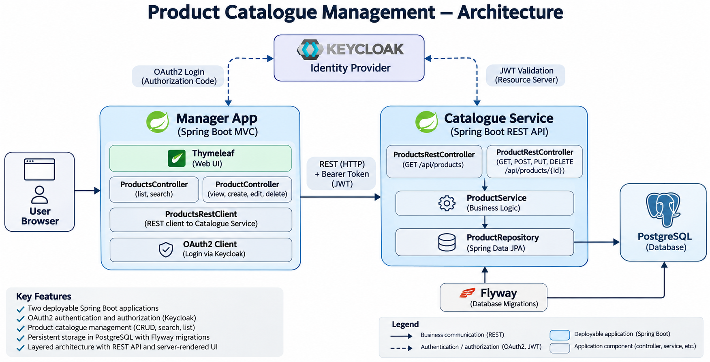

# Product Catalogue Management System

A multi-module Java application for managing a product catalogue through a secured REST API and a web-based administration interface. Built with Spring Boot, PostgreSQL, and Keycloak, the project demonstrates service-to-service communication, OAuth2/OpenID Connect security, database migrations, and automated unit and integration testing.

## Features

- **Product management:** create, view, update, and delete products.
- **Catalogue search:** filter products by title through the REST API and management UI.
- **Web administration:** Thymeleaf-based pages for browsing, creating, editing, and deleting products.
- **Authentication and authorization:** Keycloak login for managers, JWT-protected API endpoints, and scope-based access control.
- **Input validation:** constraints on product titles and descriptions, with structured API errors and validation feedback in the UI.
- **Database persistence:** Spring Data JPA/Hibernate with PostgreSQL and Flyway schema migrations.
- **Automated testing:** controller and service tests, repository integration tests using Testcontainers, and HTTP-client integration tests using WireMock.

## Tech Stack

| Area | Technologies                                                              |
| --- |---------------------------------------------------------------------------|
| Language | Java 21                                                                   |
| Framework | Spring Boot                                                               |
| Persistence | Spring Data JPA, Hibernate, PostgreSQL, Flyway                            |
| Security | Spring Security, OAuth2, OpenID Connect, Keycloak, JWT                    |
| Web UI | Thymeleaf                                                                 |
| HTTP integration | Spring `RestClient`                                                       |
| Testing | JUnit 5, Spring Boot Test, Spring Security Test, Testcontainers, WireMock |
| Build | Maven (multi-module)                                                      |

## Architecture

The project separates the management interface from the catalogue API into two independently runnable Spring Boot applications.



### Modules

- **`manager-app/`** — server-rendered administration application. Uses Spring MVC controllers and Thymeleaf templates, authenticates users through Keycloak, and calls the catalogue API through a Spring `RestClient` with OAuth2 support.
- **`catalogue-service/`** — REST API implementing catalogue operations, validation, service logic, persistence, and JWT-based authorization.
- **`config/keycloak/import/`** — example Keycloak realm configuration for local development.

The catalogue service follows a controller → service → repository structure, keeping HTTP handling, business operations, and data access separate.

## REST API

Base URL when running the catalogue service with the `standalone` profile: `http://localhost:8081`.

| Method | Endpoint | Description | Required scope |
| --- | --- | --- | --- |
| `GET` | `/catalogue-api/products` | List products; optional `filter` query parameter | `view_catalogue` |
| `GET` | `/catalogue-api/products/{productId}` | Get a product by ID | `view_catalogue` |
| `POST` | `/catalogue-api/products` | Create a product | `edit_catalogue` |
| `PATCH` | `/catalogue-api/products/{productId}` | Update a product | `edit_catalogue` |
| `DELETE` | `/catalogue-api/products/{productId}` | Delete a product | `edit_catalogue` |

Example create request (requires an access token with the `edit_catalogue` scope):

```bash
curl -X POST http://localhost:8081/catalogue-api/products \
  -H "Authorization: Bearer <ACCESS_TOKEN>" \
  -H "Content-Type: application/json" \
  -d '{"title":"Wireless Mouse","details":"Ergonomic wireless mouse"}'
```

A successful creation returns **201 Created** with the new product and a `Location` header. Successful updates and deletions return **204 No Content**. Validation failures are handled using Spring's error handling and `ProblemDetail` responses.

## Testing

The repository includes both unit and integration tests across the two modules:

- **Catalogue service:** service-layer unit tests, controller tests, controller integration tests, and PostgreSQL repository integration tests.
- **Manager app:** MVC controller tests and integration tests, plus tests for the OAuth2 HTTP request interceptor.
- **Test infrastructure:** Testcontainers-backed PostgreSQL for persistence tests and WireMock for HTTP integration scenarios.